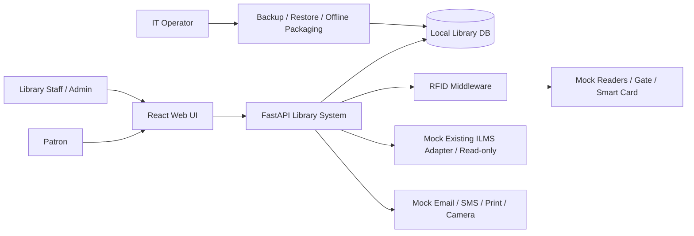
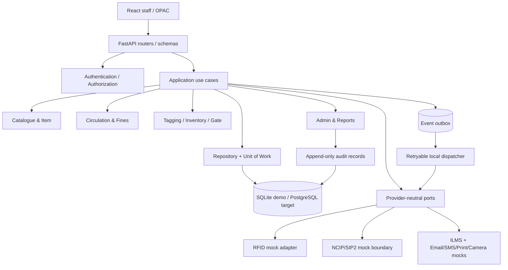
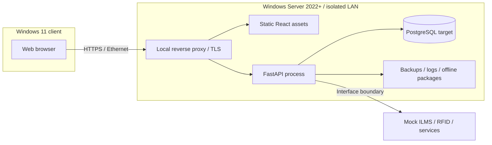

# AISYS Phase 2 — Architecture Design v0.1
Status: PROPOSED / awaiting candidate design review. Date: 2026-11-08. Primary reference: AISYS Candidate Software Development SOP pp. 1–7; Phase 1 baseline v0.2. No implementation or tests are claimed.

## Scope, architectural decisions and constraints
- React/TypeScript browser UI; Python FastAPI typed HTTP boundary; Python domain/application services; repository/transaction abstractions; SQLite for isolated demonstration; PostgreSQL proposed for deployment after additional validation.
- Modular monolith: catalog, members, circulation, tagging, inventory, gates, reports, notifications, administration, migration. Modules interact through application interfaces, not direct cross-module writes.
- Device-neutral RFID gateway and mocks for staff/handheld/gate/smart card; interfaces for print, camera, SMTP/SMS; protocol boundaries for NCIP 2.0/SIP2 (NOT actual compliant implementations).
- No physical hardware, live ILMS, production credentials, data, or certified interoperability.
- Source ILMS is read-only by default; local system owns its synthetic operational writes. No direct writes into vendor ILMS database. Any bidirectional integration requires approved contracts, reconciliation, and separately verified tests.
- Datastore transaction is authoritative for item/loan changes. External communications use durable outbox; retries must never recreate a successful loan.
- Isolation mode is explicit; external endpoints and auto-updates are disabled by default.

## Context diagram

## Component diagram

## Deployment diagram: isolated site (PROPOSED, not verified)

For prototype, a developer Windows PC runs React dev server, FastAPI and a local SQLite file. Windows Server 2022+, production PostgreSQL, TLS termination, and no-network installation have not been deployed or tested. Proposed firewall: client HTTPS to proxy; internal API/database isolated, DB not Internet exposed. Hostnames, IPs and ports are placeholders until deployment site decisions.

## Important sequences
### Checkout
1. Staff authenticated, `circulation:write` authorized.
2. Resolve mock tag -> item; resolve member; reject missing, blocked, over-limit, reference, unavailable or duplicate active loan.
3. Begin transaction; conditional item state update / serialize access; create loan, state transition and audit entry; append outbox event; commit.
4. Return loan response. Retry with same idempotency key returns stored response; conflicting request payload with same key returns 409.
5. Outbox dispatches mock NCIP/SIP2/device security-bit action. Device failure creates retryable integration status, not silent database rollback; reconciliation alerts operator. No actual protocol compliance asserted.

### Return
1. Resolve active loan; within transaction set returned_at, mark item available, calculate any configured fine, write audit and outbox. 2. Dispatch security-bit change mock asynchronously. 3. Duplicate return is handled deterministically (conflict or idempotent repeat with same key).

### Gate event without LMS
Local reader simulator emits unique event_id, tag EPC and security bit; on network loss mock middleware persists event in bounded durable local queue; if security bit denotes armed and item cannot be confirmed issued, trigger simulated alarm and persist provisional incident. On reconnect, replay idempotently into API, enrich with accession number and queue simulated camera/email. Never pretend offline authorization is definitive; distinguish `provisional` vs `reconciled`.

## Availability, consistency and observability
- SQLite single-writer limits prototype concurrency; DB contention produces bounded retry or 409. PostgreSQL design uses row locking / conditional updates and unique active-loan constraints.
- Outbox + inbox deduplication for at-least-once deliveries; no assumed exactly-once external effects.
- Correlation IDs in API, audit and events. `/health/live`, `/health/ready`, dependency health. Structured JSON logs redact credentials, card identifiers and contact details.
- Search: SQLite FTS5 as optional prototype index, PostgreSQL full-text as proposed target. Transactional catalogue remains source of truth; rebuild index after bulk migration. Network cataloguing and real-time indexing are design-only until implemented and tested.

## Architectural decisions
| ID | Decision | Rationale | Internal disposition |
|---|---|---|---|
| ADR-001 | Layered modular monolith | Simpler development and deployment for one developer | Recommended for acceptance |
| ADR-002 | Ports and mock adapters | External devices and ILMS unavailable | Recommended for acceptance |
| ADR-003 | SQLite prototype and PostgreSQL production design | Portable demonstration with documented production target | Recommended; portability testing pending |
| ADR-004 | Read-only external ILMS boundary | Prevent unauthorized modifications to legacy records | Recommended for acceptance |
| ADR-005 | Database transactions and outbox | Consistent local state and reliable event retries | Recommended for acceptance |
| ADR-006 | Server-side RBAC | Prevent authorization bypass through the frontend | Recommended for acceptance |
| ADR-007 | Synthetic-only data | Protect institutional and personal information | Recommended for acceptance |
| ADR-008 | Offline deployment design | Meet isolated-site operational requirements | Recommended; execution verification pending |

These are internal candidate recommendations, not external
AISYS approvals or evidence of production readiness.

## Open architecture questions
CL01 vendor ILMS schema/write permissions; CL02 actual RFID SDK/protocol and tag EPC format; CL03 policy periods/fine limits; CL04 source spreadsheet map; CL05 email/SMS/camera/print endpoints; CL06 offline deployment packaging standards; CL07 site network/IP and credentials. Decisions remain candidate proposals until independently reviewed.
