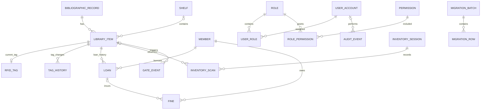

# Domain, Schema and Constraints v0.1 — DESIGN ONLY

## Conceptual ER diagram

Outbox/audit association is a logical correlation, not mandatory SQL foreign key. Some gate scans have unknown tags and thus nullable item_id. Logical many-to-many user/role is implemented via user_roles.

## Entity catalog (PK UUID string in SQLite; UUID in PostgreSQL)
- bibliographic_records: id PK, title NOT NULL, author, isbn, language, edition, subject, created_at, updated_at; optional nullable ISBN (not globally unique for editions/copies).
- library_items: id PK, bib_id FK NOT NULL, accession_number UNIQUE NOT NULL, barcode UNIQUE nullable, shelf_id FK nullable, is_reference BOOLEAN NOT NULL default false, status enum AVAILABLE/CHECKED_OUT/LOST/REPAIR/WITHDRAWN, version integer NOT NULL default 0; deleted items use withdrawal, not destructive delete.
- shelves: id PK, code UNIQUE NOT NULL, location, description.
- rfid_tags: id PK, epc UNIQUE NOT NULL, item_id UNIQUE FK NOT NULL, security_armed BOOLEAN NOT NULL default true, tagged_at, last_seen_at, status ACTIVE/RETIRED; design v0.1 keeps one current tag per item; re-tag archive to tag_history before reassignment.
- tag_history: id PK, item_id FK, prior_epc, new_epc, reason, actor_id FK, occurred_at.
- members: id PK, external_ref UNIQUE nullable, card_number UNIQUE NOT NULL, display_name, status ACTIVE/BLOCKED/EXPIRED, fine_limit_override_minor nullable, created_at; demo synthetic names only.
- loans: id PK, item_id FK, member_id FK, checked_out_at NOT NULL, due_at NOT NULL, returned_at nullable, renewed_count integer >=0, issued_by FK user_account, returned_by nullable FK; prevent more than one active loan per item.
- fines: id PK, member_id FK, loan_id FK nullable, amount_minor integer >=0, paid_minor integer 0..amount_minor, status OPEN/PAID/WAIVED, assessed_at, currency configurable; outstanding derived as SUM(amount_minor-paid_minor), not trusted client column.
- user_accounts: id PK, username UNIQUE NOT NULL, password_hash nullable for external auth, is_active, created_at; no plaintext secrets.
- roles: id PK, code UNIQUE (ADMIN/LIBRARIAN/CATALOGUER/INVENTORY/PATRON); permissions: code PK; role_permissions(role_id,permission_code) composite PK; user_roles(user_id,role_id) composite PK.
- audit_events: id PK, actor_id nullable, action, entity_type, entity_id, outcome, correlation_id, occurred_at, redacted_before_json, redacted_after_json; append-only and access restricted; application is not permitted to update/delete.
- inventory_sessions: id PK, shelf_id FK, started_at, ended_at, operator_id, status OPEN/FINALIZED; inventory_scans: id PK, session_id FK, item_id FK nullable, epc, seen_at, observed_shelf_id FK nullable. Scans represent observations. Missing and misplaced items are derived by reconciling the expected shelf snapshot against observed scans when the session is finalized.
- gate_events: id PK, source_event_id UNIQUE NOT NULL, epc, item_id FK nullable, accession_snapshot nullable, security_armed, alarm, footfall_delta nullable, camera_photo_ref nullable, status PROVISIONAL/RECONCILED, occurred_at, received_at.
- notification_preferences: member_id FK, channel EMAIL/SMS/PRINT, enabled boolean, composite PK(member_id,channel); notification_jobs: id PK, channel, template, redacted_recipient_ref, payload_json, status QUEUED/SENT/FAILED, attempts.
- migration_batches: id PK, source_filename, file_sha256, status STAGED/VALIDATED/DRY_RUN/COMMITTED/FAILED/ROLLED_BACK, source_count, accepted_count, rejected_count, duplicate_count, inserted_count, updated_count, unchanged_count, started_at, completed_at. Source rows reconcile as accepted + rejected + duplicate; committed accepted rows reconcile as inserted + updated + unchanged. Target row-count delta normally equals inserted_count when updates are in-place.
- migration_rows: id PK, batch_id FK, source_row_number, source_key, raw_json, normalized_json, status ACCEPTED/REJECTED/DUPLICATE, error_codes; UNIQUE(batch_id,source_row_number).
- idempotency_records: key PK, operation, request_hash, response_code, response_json, created_at, expires_at.
- outbox_events: id PK, event_type, aggregate_type, aggregate_id, schema_version, payload_json, correlation_id, occurred_at, status, attempts, next_attempt_at.
- inbox_events: source, event_id, received_at; composite PK(source,event_id).
- system_config: key PK, typed_value_json, edited_by, updated_at. Never store secrets here.

## Physical schema highlights and integrity design
PostgreSQL: `CREATE UNIQUE INDEX uq_active_loan_per_item ON loans(item_id) WHERE returned_at IS NULL;` SQLite supports the same partial index. `CREATE UNIQUE INDEX uq_rfid_epc ON rfid_tags(epc);` For boolean and status enums, use named CHECK constraints in SQLite, CHECK or enumerated types in PostgreSQL. All FK references enabled in SQLite by `PRAGMA foreign_keys=ON` for every connection. `CHECK (due_at > checked_out_at)`, `CHECK (returned_at IS NULL OR returned_at >= checked_out_at)`, `CHECK (renewed_count >= 0)`, `CHECK (paid_minor >= 0 AND paid_minor <= amount_minor)`.

All timestamps are stored in UTC in ISO 8601 (SQLite) and `TIMESTAMPTZ` (PostgreSQL). Normalize ISBN where usable, but no globally mandatory uniqueness on ISBN. Amounts stored in integer minor units, currency separately to avoid float rounding. IDs remain stable across imports; external IDs mapped to separate source_key. Restrict deletion of referenced members, items and loans. For privacy retention, use reviewed anonymization process that does not corrupt accounting/audit history.

## Concurrency and state invariants
- Active loan unique by item; `CHECKED_OUT` item requires precisely one active loan, enforced at application transaction boundary plus verification query (cross-table invariant not expressible with a simple CHECK).
- Checkout atomic: precondition eligibility, item status change, loan insert, audit insert, outbox insert all in one DB transaction. PostgreSQL `SELECT ... FOR UPDATE` on item; SQLite `BEGIN IMMEDIATE` / conditional update.
- Return transitions only an active loan; renewal cannot exceed configured max or exceed member eligibility.
- Tag EPC unique; retag archives the prior association in tag_history, replaces the current tag, and records an audit event in one transaction. Previously retired EPCs cannot silently become active again. One current tag per item. Gate events with unknown EPCs are accepted as provisional.
- Event and API dedup keys unique, bounded retention, stable error results.

## SQL example — illustrative PostgreSQL DDL, NOT executed
```sql
CREATE TABLE bibliographic_records (
  id UUID PRIMARY KEY,
  title TEXT NOT NULL,
  author TEXT,
  isbn VARCHAR(20),
  created_at TIMESTAMPTZ NOT NULL,
  updated_at TIMESTAMPTZ NOT NULL
);
CREATE TABLE library_items (
  id UUID PRIMARY KEY,
  bib_id UUID NOT NULL REFERENCES bibliographic_records(id),
  accession_number VARCHAR(64) NOT NULL UNIQUE,
  is_reference BOOLEAN NOT NULL DEFAULT FALSE,
  status VARCHAR(20) NOT NULL CHECK(status IN ('AVAILABLE','CHECKED_OUT','LOST','REPAIR','WITHDRAWN')),
  version INTEGER NOT NULL DEFAULT 0 CHECK(version >= 0)
);
CREATE TABLE loans (
  id UUID PRIMARY KEY,
  item_id UUID NOT NULL REFERENCES library_items(id),
  member_id UUID NOT NULL, -- FK to members in full migration
  checked_out_at TIMESTAMPTZ NOT NULL,
  due_at TIMESTAMPTZ NOT NULL,
  returned_at TIMESTAMPTZ,
  renewed_count INTEGER NOT NULL DEFAULT 0 CHECK(renewed_count >= 0),
  CHECK(due_at > checked_out_at),
  CHECK(returned_at IS NULL OR returned_at >= checked_out_at)
);
CREATE UNIQUE INDEX uq_active_loan_per_item ON loans(item_id) WHERE returned_at IS NULL;
```
This snippet is illustrative, not a full runnable migration. Full versioned Alembic migrations are Phase 3/4 implementation work.

## Database Design Review — 2026-11-08

Status: REVIEWED WITH CHANGES REQUIRED.
This section records proposed corrections; no database
migration has been implemented or executed.

### DBR-01: RFID tag lifecycle
Use one current tag record per item. A re-tag operation
must archive the previous association in tag_history and
replace the current tag atomically.

A retired EPC must not be treated as an active credential.

### DBR-02: Inventory reconciliation
Inventory scans represent observed item reads.
Missing items are derived by comparing expected items
with observed items when closing an inventory session.

Misplaced items are identified by comparing the expected
shelf and observed shelf.

The reconciliation result must be reproducible and
associated with the inventory session.

### DBR-03: ER diagram refinement
Add user_roles and role_permissions as junction entities.
Remove the mandatory outbox-to-audit relationship.
Correlation IDs may link records logically without an FK.

### DBR-04: Migration reconciliation
Require source_count =
accepted_count + rejected_count + duplicate_count.

Distinguish accepted inserts from accepted updates.
A committed batch must reconcile against target writes.

Use source-system identity and stable business keys to
prevent duplicate records during repeated imports.

### DBR-05: Integrity and concurrency
Enforce status and monetary CHECK constraints.
Use restrictive foreign-key deletion rules.
Maintain unique active loans and RFID event identifiers.

Checkout, renewal and return must be transactional.
Database constraints must remain the final protection
against concurrent conflicting operations.

### Review disposition
Initial technical review complete.
Final approval pending incorporation of corrections,
ER diagram updates, API consistency review and verification.


## Final Integrity Requirements

### Inventory snapshot consistency
When an inventory session begins, capture the expected
items and shelf assignments in a session-specific snapshot.

Finalization compares observed scans with that snapshot.
Missing and misplaced classifications must be reproducible.

### RFID EPC history
Retired EPC associations remain in tag_history.
Previously used EPC values must not be silently reused.
Any future EPC reuse requires an explicit audited policy.

### Migration reconciliation invariants
source_count =
accepted_count + rejected_count + duplicate_count

accepted_count =
inserted_count + updated_count + unchanged_count

All counts must be nonnegative.
For an insert/update-only migration with no deletions,
target row-count increase equals inserted_count.
Updates and unchanged records do not increase row count.

### Database constraints
Require appropriate primary keys, foreign keys,
unique constraints and CHECK constraints.
Use a partial unique index to enforce one active
loan per physical item.

SQLite connections must enable foreign-key enforcement.
PostgreSQL transactions must use concurrency-safe locking.
Every circulation mutation records its audit and outbox
events in the same successful database transaction.

### Outstanding implementation detail
The logical rules above must be translated into complete,
versioned SQLite migrations during Phase 3.
PostgreSQL-specific DDL remains production design work.
No database migration has been executed.

## Cross-Document Consistency Decisions

### CONS-01: RFID security synchronization
The local application tracks desired RFID security state
separately from the last acknowledged device state.

Design a tag_security_sync record containing:
id, tag_id, desired_armed, acknowledged_armed,
sync_status, attempts, updated_at and last_error_code.

The checkout/return transaction must persist the
desired-state change and corresponding outbox event.
Device acknowledgement updates the synchronization
record separately.

No physical device change is claimed before acknowledgement.

### CONS-02: Inventory expected-item snapshots
Define inventory_expected_items with:
session_id, item_id, expected_shelf_id and captured_at.

Use composite uniqueness on (session_id, item_id).
Capture expected items at inventory-session creation.

Final reconciliation compares expected items with
observed inventory_scans and records the finalized
result reproducibly.

### CONS-03: Migration accounting
A committed migration batch must satisfy:

source_count =
accepted_count + rejected_count + duplicate_count

accepted_count =
inserted_count + updated_count + unchanged_count

All counts must be nonnegative.

The prototype uses one atomic SQLite transaction
for target inserts/updates and committed batch accounting.
A failed commit must not leave partial target changes.

Any later chunked strategy requires separate recovery
and reconciliation semantics.

### Consistency review status
These decisions refine the logical schema.
Complete physical migrations and runtime verification
remain implementation tasks.
